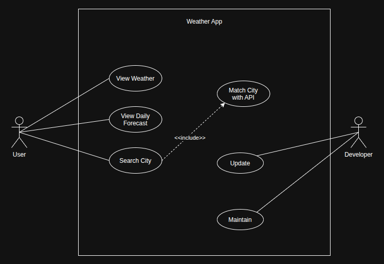

# React Native Expo Weather App

[](https://reactnative.dev/)
[](https://expo.dev/)
[](https://www.nativewind.dev/)

A sleek, responsive, and cross-platform weather application built with React Native, Expo, Tailwind CSS (NativeWind), and the WeatherAPI. The app provides real-time current weather conditions, location search with auto-complete suggestions, and a multi-day forecast horizontal slider.

## ✨ Key Features

* Real-Time Weather Data: Fetches live weather information including temperature, condition descriptions, wind speed, humidity, and location details.
* Location Search with Debounce: Clean search interface featuring debounced API requests (lodash.debounce) to optimize network calls while typing.
* Multi-Day Forecast: Smooth horizontal scrollable daily forecast cards with dynamically mapped weather icons and accurately parsed local day names.
* Safe Local Date Parsing: Custom date parsing logic (YYYY-MM-DD index splitting) preventing timezone shifts and standardizing weekday display across both iOS and Android engines.
* Defensive Data Handling: Uses optional chaining (?.) and nullish coalescing (??) to guarantee smooth rendering without runtime crashes during data loading.
* Responsive Styling: Tailwind CSS via NativeWind v4 with dynamic layout support preventing text clipping and overflowing across various device sizes.

## 🛠️ Tech Stack & Dependencies

* Framework: React Native / Expo
* Styling: NativeWind v4 (Tailwind CSS for React Native)
* API Client: Axios
* Icons: React Native Heroicons & Custom PNG Assets
* Utilities: Lodash (debounce)
* Progress / Loaders: react-native-progress
* Safe Area Management: react-native-safe-area-context

## 💻 Installation & Setup

1. Clone the Repository
   ```bash
   git clone https://github.com/prajanshrestha10/weather-app.git
   
   cd weather-app
   ```

2. Install Dependencies
   ```bash
   npm install
   ```

3. Configure API Key
   Create an api/weather.js (or .env) file with your WeatherAPI key:
   ```bash
   export const apiKey = 'YOUR_WEATHER_API_KEY';
   ```
   
4. Start the Expo Development Server
   ```bash
   npx expo start
   ```

5. Run on Device / Emulator
   ```bash
   Press 'i' for iOS Simulator.
   Press 'a' for Android Emulator.
   Scan the QR code using the Expo Go app on your physical iOS/Android device.
   ```

## 📂 Project Structure
```
├── assets/
│   └── weather-app-assets/   # Backgrounds, weather condition icons, and stats icons
├── src/
│   ├── api/
│   │   └── weather.js        # Axios network requests for forecast and search auto-complete
│   ├── constants/
│   │   └── index.js          # Weather condition image mapping lookups
│   ├── themes/
│   │   └── index.js          # Dynamic UI theme configurations
│   └── screens/
│       └── HomeScreen.js     # Main application layout and state management
├── App.js
├── package.json
└── README.md
```

## 📐 Use Case Diagram

Weather App



## 📱 Screen Breakdown (HomeScreen.js)

* Search Bar Header: Toggleable input field with search suggestion dropdown list wrapped in auto-truncating layout blocks to prevent text clipping on long location names.
* Current Weather Hero: Highlights location name, dynamic condition icon from mapped state, temperature in Fahrenheit/Celsius, and current condition summary.
* Stat Indicators: Quick-glance icons for Wind Speed (mph), Humidity (%), and Sunrise time.
* Daily Forecast Carousel: Horizontal ScrollView displaying daily high/low forecast cards with parsed day names.

## 👤 Author

**Prajan Shrestha**

* **Project:** Weather App

## 🔗 YouTube Link(s)

* *[Link Here]*

## 💼 LinkedIn Post Link(s)

* *[Link Here]*

## 📄 License

This project is open-source and available under the MIT License. See `LICENSE` for more information.
